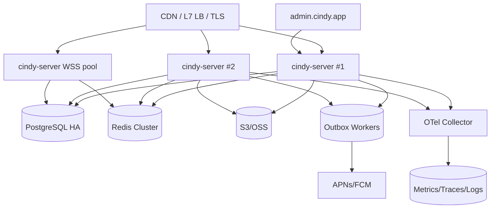

# 部署与运行

> 覆盖本地开发与生产部署。所有连接信息通过环境变量注入，不写死。

---

## 1. 本地开发

### 1.1 前置

- Go 1.26+
- Docker 29+ / Compose v2+
- Node 26 + pnpm 10（仅 admin UI）
- `openssl`（生成 JWT 密钥）

### 1.2 一键流程

```bash
cd cindy-server

# 1) 启动中间件
docker compose -p cindy-middlewares -f deploy/compose/docker-compose.yml up -d

# 2) 配置
cp .env.example .env
make keys          # 生成 .keys/jwt-ed25519.pem（若不存在）

# 3) 迁移 + 种子
make migrate
make seed

# 4) 启动服务
make run           # :19828

# 5) 管理台
cd ../cindy-admin && pnpm install && pnpm dev   # :15900，代理 /admin/api -> :19828
```

### 1.3 验证

```bash
curl -s http://127.0.0.1:19828/healthz
curl -s http://127.0.0.1:19828/readyz
curl -s http://127.0.0.1:19828/api/auth/providers
curl -s http://127.0.0.1:19828/api/model-catalog/catalog | head
```

- 默认管理员：`.env` 中 `CINDY_ADMIN_BOOTSTRAP_*`；首次登录强制改密（生产）。
- 开发验证码：`123456`；同时可在 Mailpit 查看邮件。

### 1.4 本地域名（可选）

在 `/etc/hosts` 添加：

```
127.0.0.1 auth.cindy.local chat.cindy.local device-link.cindy.local model-access.cindy.local plugin.cindy.local skill-hub.cindy.local admin.cindy.local
```

Caddy 示例（`deploy/caddy/Caddyfile.local`）：

```
{
  local_certs
}

auth.cindy.local, chat.cindy.local, device-link.cindy.local,
model-access.cindy.local, plugin.cindy.local, skill-hub.cindy.local,
oss.cindy.local, heartbeat.cindy.local, mobile-update.cindy.local {
  reverse_proxy 127.0.0.1:19828
}

admin.cindy.local {
  reverse_proxy 127.0.0.1:15900
}
```

> 客户端 dev 使用 `127.0.0.1` 而非 `localhost`；若需真机调试，把端点改成局域网 IP，并同步 S3 预签名 endpoint。

---

## 2. 生产拓扑



- 无状态 API 可水平扩容；WSS 需要粘性会话或按 deviceId 路由。
- 多实例扇出：Redis Pub/Sub + 每实例本地 hub；消息持久化后再广播。
- 迁移在发布前由单独 Job 执行；应用启动只校验版本。
- 数据库读写分离可选；强一致查询走主库。
- 对象存储使用 CDN 回源公开桶；私有对象只走预签名。

---

## 3. 环境与密钥

| 环境 | 说明 |
|---|---|
| `dev` | 固定验证码、宽松日志、CORS 允许 localhost |
| `staging` | 接近生产，独立密钥与数据 |
| `prod` | 关闭固定码、强制 TLS、审计全开 |

密钥管理：

- JWT Ed25519 私钥：KMS/Secret Manager；公钥通过 `/.well-known/jwks.json` 暴露。
- 数据库/Redis/S3：托管凭证；每环境独立。
- BYOK 主密钥：KMS；信封加密（DEK + KEK），支持密钥版本。
- TURN secret、APNs key、FCM credentials：Secret 文件挂载，不写环境变量明文（可用 `_FILE` 后缀）。
- 轮换：JWT 双 key 过渡（kid）；数据密钥支持 `key_version`。

---

## 4. 反向代理与安全头

```caddy
api.cindy.app {
  encode zstd gzip
  header {
    Strict-Transport-Security "max-age=31536000; includeSubDomains"
    X-Content-Type-Options "nosniff"
    Referrer-Policy "strict-origin-when-cross-origin"
  }
  reverse_proxy 127.0.0.1:19828
}
```

- WebSocket 需要 `Upgrade`/`Connection` 透传与足够 idle timeout（≥ 90s）。
- 请求体上限按路由：普通 1 MiB；上传走 S3 不经过 API。
- 超时：普通 30s；Chat 15s 客户端侧；WSS 长连接。
- 管理台独立域名与 IP 允许列表（可选）。

---

## 5. 发布流程

1. CI：`go vet`、`go test ./...`、构建、前端 `pnpm build`、镜像扫描。
2. 迁移 Job（可回滚的向前迁移）。
3. 金丝雀：5% 流量 → 观察错误率/延迟 → 25% → 100%。
4. 回滚：应用回滚；迁移保持向后兼容（不删列）。
5. WSS：滚动重启时客户端自动重连；先摘流再停实例。

---

## 6. 备份与恢复

| 数据 | 策略 |
|---|---|
| PostgreSQL | 每日全量 + WAL 归档；RPO ≤ 5min；季度恢复演练 |
| Redis | 可丢失（presence/限流）；会话索引可从 PG 重建 |
| 对象存储 | 版本化 + 跨区复制（可选）；生命周期 |
| 配置/密钥 | Secret Manager 版本化；离线备份 |

恢复顺序：PG → 应用 → Redis（自动重建）→ 对象存储校验。

---

## 7. 运行手册（摘要）

| 症状 | 排查 |
|---|---|
| 登录 500 | 检查 SMTP、验证码表、Turnstile 配置 |
| 大面积 401 | JWT 密钥/JWKS 不一致、时钟偏移 |
| device-link 全离线 | WSS 反代配置、Redis 路由、连接上限 |
| 消息延迟 | Outbox 积压、Redis Pub/Sub、DB 锁 |
| 上传失败 | S3 凭证、bucket 权限、预签名 endpoint 可达性 |
| 推送失败 | APNs 证书/环境（prod/sandbox）、token 失效 |
| 管理台 403 | RBAC、会话过期、CSRF |

所有告警附 runbook 链接；高风险操作双人复核。
