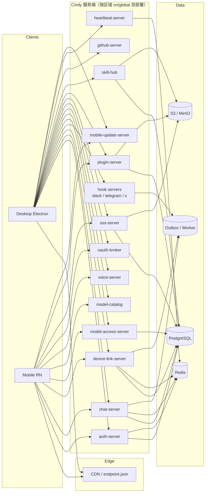

# Cindy 服务端能力重建总览

> 文档定位：阶段 1「服务端能力清单」总纲。基于开源客户端 `cindy` 与公开协议仓 `cindy-protocol` 逆向重建闭源服务端。
>
> 证据等级：**【契约】** = 客户端严格解析/测试固化的 wire 契约；**【文档】** = 仓内产品/开发规则明确描述的服务端行为；**【推测】** = 由字段、错误码或调用行为反推，需服务端实现时自行定义。
>
> 生成日期：2026-10-18。源码快照：`cindy`（2026-10-19 工作区）、`cindy-protocol`（2026-08-10 最后提交）。

---

## 1. 逆向边界与方法

### 1.1 可观测面

客户端与服务端之间存在五类可观测契约：

1. **严格 wire parser**：`zod`/手写 parser 对响应字段的必选/可选、枚举、长度、正则约束。服务端返回不符即被客户端拒绝，这是最高等级证据。
2. **调用点**：请求方法、路径、查询参数、请求体、请求头、超时、重试、幂等键、401/429 分支。
3. **共享协议包**：`cindy-protocol` 与客户端本地副本（后者是实际消费的超集）。
4. **产品/开发文档**：明确写出服务端职责、状态机、上限、兼容策略。
5. **本地测试夹具**：`scripts/device-link/relayFixture.ts` 等最小服务端模拟，可用于还原协议行为。

### 1.2 不可观测面

以下内容客户端无法证明，本套文档统一标注为推测，实现时允许自定义但必须满足客户端契约：

- 数据库表结构与 ORM 命名
- 服务端内部服务拆分与消息队列
- 审核后台的具体工作流
- 限流阈值、缓存 TTL、分片策略
- 第三方密钥（GitHub App、APNs、Turnstile、OSS、SLS）配置

### 1.3 一个重要事实：客户端自带两代协议副本

`cindy/packages/*` 与 `cindy-protocol/packages/*` 同名协议包并非同一份代码。客户端规则明确要求两仓各自维护、不跨仓 import；`cindy-protocol` 是公开契约快照，客户端本地副本通常更新（例如 hook 消息 42 种 vs 41 种，device-link 增加 `sharedTask`/`providerShare` scope）。**重建服务端时以客户端本地副本为“上位集”，以 `cindy-protocol` 为兼容基线。**

---

## 2. 服务拓扑

### 2.1 区域部署

- `cn` 与 `global` 是**两套独立部署、独立数据、独立账号体系**。
- 端点清单按构建区域烘焙，客户端从 CDN 拉取 `<cdnBaseUrl>/endpoint.json`；`auth`/`device-link`/`oauth-broker`/`model-access`/`voice` 等服务随账号区域切换。
- 唯一跨区共享：`chatApiBaseUrl` 与三个 hook WS 地址（见 `docs/auth-realm-routing.md`）。
- 服务端必须在 `providers`、`sso/discovery` 响应中回带 `region`，不匹配时客户端 `REGION_MISMATCH` fail-closed。

### 2.2 端点基址

| 服务 | 配置键 | CN | Global | Dev 示例 |
|---|---|---|---|---|
| Auth | `authApiBaseUrl` | `https://auth.cindy.com.cn` | `https://auth.cindy.app` | `http://localhost:3344` |
| Chat | `chatApiBaseUrl` | `https://chat.cindy.app` | `https://chat.cindy.app` | 共用 |
| Device Link | `deviceLinkApiBaseUrl` | `https://device-link.cindy.com.cn` | `https://device-link.cindy.app` | `:3335` |
| OAuth Broker | `oauthBrokerApiBaseUrl` | `https://oauth-broker.cindy.com.cn` | `https://oauth-broker.cindy.app` | `:3337` |
| OSS | `ossApiBaseUrl` | `https://oss.cindy.com.cn` | `https://oss.cindy.app` | `:3340` |
| Heartbeat | `heartbeatUrl` | `https://heartbeat.cindy.com.cn` | `https://heartbeat.cindy.app` | `:3338` |
| Model Access | `modelAccessApiBaseUrl` | `https://model-access.cindy.com.cn` | `https://model-access.cindy.app` | `:3339` |
| Voice | `voiceApiBaseUrl` | `https://voice.cindy.com.cn` | `https://voice.cindy.app` | `:3342` |
| GitHub | `githubApiBaseUrl` | `https://github.cindy.com.cn` | `https://github.cindy.app` | `:3336` |
| Skill Hub（旧） | `skillhubApiBaseUrl` | `https://xd-skillhub.cindy.com.cn` | `https://xd-skillhub.cindy.app` | `:3341` |
| Skill Hub（新） | `cindySkillHubApiBaseUrl` | `https://skill-hub.cindy.com.cn` | `https://skill-hub.cindy.app` | `:3345` |
| Plugin | `pluginApiBaseUrl` | `https://plugin.cindy.com.cn` | `https://plugin.cindy.app` | `:3343` |
| CDN | `cdnBaseUrl` | `https://hotfix.cindy.com.cn/cindy` | `https://hotfix.cindy.app/cindy` | `:3345/cindy` |
| Mobile Update | `mobileUpdateBaseUrl` | `https://mobile-update.cindy.com.cn` | `https://mobile-update.cindy.app` | — |
| Hook WS | `hooks.*` | `wss://slack-hook.cindy.app` 等 | 同左 | — |

> Dev 示例端口来自 `config/endpoint.dev.json.example`，可作为本地一键起服的端口规划参考。

---

## 3. 鉴权体系

| 凭证 | 使用方 | 形态 | 生命周期/说明 |
|---|---|---|---|
| Access Token | 全部业务服务 | `Authorization: Bearer <jwt>` | 短期；桌面/移动 401 自动 refresh 一次 |
| Refresh Token | auth-server | 不透明或 JWT | 轮换；多实例竞态容忍；登出吊销 |
| Account Token | 多账号选择 | 账号级令牌 | 与 Resource Membership 分离；可跨 Membership |
| Login Ticket | 多账号选择 | 短时票据 | `select_account` 后换取目标 membership token |
| Bind Ticket | 补绑流程 | 短时票据 | `binding_required` |
| Verification Ticket | SSO 二次验证 | 短时票据 | `sso_verification_required` |
| ProviderShareGuest | device-link relay | `Authorization: ProviderShareGuest <credential>` | 24h；只存摘要；轮换即失效；仅 providerShare scope |
| Connection JWT | plugin-server 发布 | Bearer | audience `<orgSlug>:cindy-publisher`；绑定组织 Membership |
| Device Identity | device-link（预留） | `x-cindy-identity-*` ES256 签名 | 绑定 path/tokenHash/bodyHash；客户端尚未全量接线 |

通用请求约定：

- 错误信封：`{"error":{"code":string,"message":string,"details"?:object}}`。
- `429` 必须带 `Retry-After`（秒或 HTTP-date）。
- Chat HTTP 响应上限 8 MiB、超时 15 s；插件市场 15 s；用量上报 5 s。
- 客户端不跟随跨 host 重定向，不向签名 URL 转发 Bearer。

---

## 4. 能力域索引

| 编号 | 分册 | 能力域 | 核心服务 |
|---|---|---|---|
| 00 | 本文件 | 总览、拓扑、鉴权 | 全部 |
| 01 | [01-service-topology.md](01-service-topology.md) | 服务边界、请求约定、数据所有权 | 全部 |
| 02 | [02-auth-account.md](02-auth-account.md) | 登录、SSO、令牌、账号删除、组织 | auth-server |
| 03 | [03-chat-server.md](03-chat-server.md) | 房间、消息、云伙伴、群聊、WSS | chat-server |
| 04 | [04-device-link.md](04-device-link.md) | 设备中继、共享任务、供应商分享、推送、ICE | device-link-server |
| 05 | [05-model-access.md](05-model-access.md) | 模型目录、BYOK、计费、语音、Embedding | model-access / catalog / voice / broker |
| 06 | [06-plugin-skillhub.md](06-plugin-skillhub.md) | 插件市场、发布审核、Skill Hub | plugin-server / skill-hub |
| 07 | [07-oss-updates-observability.md](07-oss-updates-observability.md) | OSS、更新、远程配置、心跳、日志、反馈 | oss / CDN / update / heartbeat |
| 08 | [08-observability-security.md](08-observability-security.md) | 安全、审计、限流、合规横切 | 全部 |
| 09 | [09-hooks-im.md](09-hooks-im.md) | Slack/Telegram/X 双向 Hook 协议 | hook servers |
| 10 | [10-admin-console.md](10-admin-console.md) | 管理后台能力清单 | admin |

---

## 5. 能力优先级

### P0：客户端核心闭环（没有它客户端无法登录/使用）

- 认证：邮箱验证码、令牌刷新、membership、providers、区域校验、登出。
- Chat：房间/消息读写、WSS 订阅、游标补读、附件签名。
- Device-link：WSS 中继（hello/presence/ping/route）、设备目录、远程控制开关。
- Model-access：模型列表、凭据下发、quota/balance。
- OSS：头像/媒体预签名。
- Endpoint/更新：endpoint.json 与桌面更新 manifest。
- Heartbeat。

### P1：协作与商业化

- 企业 SSO、多账号、账号删除。
- 云伙伴、Bot 群聊、共享任务、供应商分享、推送。
- 插件市场与 Skill Hub 浏览/下载。
- 订阅/计费/额度。
- Hook 渠道（Slack/Telegram/X）。
- 管理后台只读查询与审核。

### P2：运营与增强

- 语音、Embedding、OAuth Broker token exchange。
- 用量统计、日志上传分析、DAU、灰度/flags。
- 审计、合规导出、风控策略后台。
- 跨区域分享、壁纸/公告运营。

---

## 6. 重建原则

1. **契约优先**：字段名、枚举、状态码必须与客户端 parser 对齐；新增字段只能 append-only。
2. **幂等优先**：Chat 的 `operationId`、插件用量 `eventId`、上传 `uploadId`、共享任务邀请 token 都必须服务端去重。
3. **区域隔离**：所有表带 `region` 或按部署物理隔离；跨区共享只在明确允许的 chat/hook 通道。
4. **权限在服务端判定，执行在设备侧**：device-link 的 allowlist/撤权在本机执行；服务端只做账号命名空间与开关路由校验。
5. **对象存储只签名不代理字节**：大文件走 S3 直传直下。
6. **可演进**：所有协议保留未知字段容忍；能力用 capability/version 协商，不做破坏性升级。

---

## 7. 与阶段 2 的衔接

阶段 1 的每个能力编号（`AUTH-xx`、`CHAT-xx`、`DL-xx`、`MODEL-xx`、`PLUGIN-xx`、`OSS-xx`、`HOOK-xx`、`ADMIN-xx`）在阶段 2 的 `docs/architecture/<module>/` 中都有对应的实现任务、表结构、接口、测试与验收标准。阶段 3 的代码以能力编号为追踪粒度。
