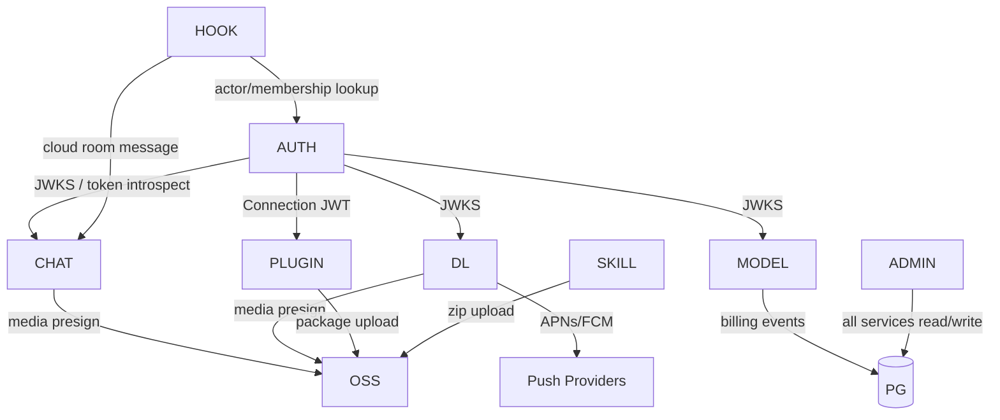

# 服务拓扑、请求约定与数据所有权

> 能力编号前缀：`SVC-`
> 证据等级：契约/文档/推测（见 00-overview）。

---

## 1. 服务边界

| 服务 | 职责 | 明确不负责 |
|---|---|---|
| auth-server | 身份、登录、令牌、Membership、组织/SSO、账号删除、OIDC Connection token | 计费、业务数据、设备在线 |
| chat-server | 云端房间/消息/线程/回应、Bot actor、执行租约、云伙伴对话层、群聊编排、WSS 事件 | 本机任务执行、设备路由 |
| device-link-server | WSS 哑中继、设备目录/presence、推送、ICE、共享任务/供应商分享 REST、媒体签票 | 会话内容、IPC 权限、字节传输 |
| hook servers | Slack/Telegram/X 接入、官方 bot、把 IM 消息转成 desktop 任务协议 | 任务执行 |
| model-access-server | 模型可用性、凭据、BYOK、配额/余额、计费/订阅 | 实际推理转发（模型调用由客户端直连或经 gateway） |
| model-catalog | 匿名公共模型注册表（schema v5） | 用户身份 |
| voice-server | 语音会话、ASR WS、润色、词典 | 通用对话 |
| oauth-broker | feature flags、第三方 OAuth token exchange/refresh | 用户登录 |
| oss-server | 预签名上传/下载、公开资产 | 字节代理、CDN 缓存 |
| plugin-server | 插件市场、发布、审核、下载签票、用量统计 | 插件运行 |
| skill-hub | 技能市场、发布/审核、组织分发 | 技能运行 |
| github-server | 代发 GitHub issue、我的 issue 聚合 | GitHub OAuth 登录 |
| heartbeat-server | 匿名/账号在线心跳与 DAU | presence/路由 |
| mobile-update-server | 移动整包与 OTA 清单 | 桌面包分发（CDN） |
| admin | 运营后台 API + WebUI | 客户端业务 |

---

## 2. 统一请求约定

### 2.1 传输

| 项 | 约定 |
|---|---|
| 协议 | 生产 HTTPS/WSS；http 仅显式 dev/loopback |
| JSON | UTF-8，字段 camelCase；时间 ISO-8601（毫秒 UTC）或 epoch ms（按端点契约） |
| 认证 | `Authorization: Bearer <accessToken>`；插件发布用 Connection JWT；跨区分享用 `ProviderShareGuest` |
| 身份代演 | Chat：`X-Chat-Actor: <actorId>` |
| 版本 | 插件 `x-cindy-version`；移动 OTA `x-cindy-update-channel`；模型目录 `schemaVersion` 查询参数 |
| 响应上限 | Chat 8 MiB；公告 8 MiB；其他端点建议 16 MiB |
| 超时 | Chat 15 s；市场 15 s；用量 5 s；心跳 5 s；日志 20 s/批 |
| 重定向 | 客户端多数不跟随；签名 URL 不得跨 host 带 Bearer |

### 2.2 错误信封

```json
{
  "error": {
    "code": "STRING_CODE",
    "message": "human readable",
    "details": {}
  }
}
```

- 401：`AUTH_REQUIRED` / `INVALID_TOKEN` / `TOKEN_EXPIRED`；客户端刷新一次。
- 403：`FORBIDDEN` / 业务码（如 `REMOTE_DISABLED`）。
- 404：资源不存在；对未授权资源优先返回 404 防探测。
- 409：幂等冲突/状态冲突。
- 413：超限；用量上报可据此减半批次。
- 429：必须 `Retry-After`。
- 5xx：客户端按端点策略退避重试。

### 2.3 幂等

| 场景 | 幂等键 | 行为 |
|---|---|---|
| Chat 写操作 | `operationId` | 同 key 同结果；不同 payload 返回冲突 |
| 插件用量 | `eventId` | `accepted` / `duplicate` / `rejected(code)` |
| 插件上传 | `uploadId` | commit 幂等；expired 仍 202 |
| 共享任务邀请 | 43 字符 token | 一次性；过期/使用后失效 |
| 消息发送 | `clientMessageId`（建议） | 去重并保证顺序 |

### 2.4 分页

- 游标优先（不透明字符串），其次 `page/pageSize`。
- 插件列表：`limit=100`，`nextCursor`；游标不前进视为错误。
- Skill Hub：`page/pageSize`，部分端点 `cursor`。
- Chat 变更流：单调递增 `seq` + `cursor`，支持补读。

### 2.5 限流

建议统一在网关按 `accountId + route + IP` 限流，并在响应头输出 `X-RateLimit-*`。已知必须存在：

- 发码/登录尝试：按邮箱/手机/IP，配合 Turnstile。
- device-link `notify`：频控，超限 `RATE_LIMITED`。
- 供应商分享写操作：按账号/guestKey/IP。
- 插件用量：批次与事件数上限。
- 上传：对象大小与账号配额。

---

## 3. 客户端启动顺序（服务端需支撑）

1. 读取随包 endpoint（或缓存）→ 拉取 `<cdnBaseUrl>/endpoint.json`，严格解析并校验区域与信任锚。
2. auth：`GET /api/auth/providers`（校验 region）→ 恢复 refresh token → 获取 access token 与 membership。
3. 并行：model-access 模型列表/配额、chat 房间列表、device-link WS 连接、heartbeat 心跳。
4. 按需：插件市场、Skill Hub 自动安装清单、更新检查、feature flags、公告。

> 服务端任何一步失败都应可降级：客户端保留缓存/离线副本，不得让单一服务阻断登录。

---

## 4. 数据所有权矩阵

| 数据 | 所有者 | 关键字段 | 备注 |
|---|---|---|---|
| 账号/Passport | auth | accountId、email、phone、social identities | 跨 membership |
| Membership | auth | membershipId、kind(personal/org)、role、orgId | 资源身份 |
| 组织/SSO | auth | org、domain、connection、protocol | 企业域路由 |
| Refresh Session | auth | sessionId、deviceId、expiry、rotation | 吊销/删除 |
| 设备目录 | device-link | deviceId、name、platform、appVersion、lastSeenAt | hello 注册 |
| Presence | device-link（Redis） | deviceId、online、busy、remoteControlEnabled | TTL |
| 共享任务 | device-link | sharedTaskId、sessionId、owner、hostDeviceId、guests、status | 30s 补偿扫描 |
| 供应商分享 | device-link | shareId、providerId、hostDeviceId、members、requests | 跨区凭证 |
| 推送 Token | device-link | token、platform、provider、appVariant、apnsEnv | 账号绑定 |
| 房间/消息 | chat | roomId、actorId、seq、content、attachments | 跨端同步 |
| 云伙伴资料 | chat + device-link | companionId、snapshot、mainDeviceId | 对话层在 chat |
| 执行租约 | chat | executionId、actorId、roomId、leaseExpiresAt | Bot 发言 |
| 模型目录 | model-catalog | registryRevision、provider、model | 公共只读 |
| 用户模型凭据 | model-access | credentialId、provider、ciphertext | BYOK |
| 配额/订阅 | model-access | plan、credits、usage | 计费 |
| 插件/Release | plugin | pluginId、releaseId、sha256、manifest | 对象在 S3 |
| Skill/Version | skill-hub | slug、version、zipSha256、visibility | 对象在 S3 |
| 对象 | oss/S3 | key、owner、acl、expiry | 私有默认 |
| Hook 绑定/任务 | hook | channel、teamId、binding、taskId | IM 会话 |
| 日志 | 外部 SLS | uploadCode、tags、logs | 服务端不落原文 |
| 审计 | admin | actor、action、target、before/after、IP | 只追加 |

---

## 5. 跨服务依赖



建议：

- JWT 使用非对称签名（EdDSA/ES256），各服务通过 JWKS 本地验签，auth 不成为每次请求的单点。
- 服务间同步调用只用于强一致场景（如 hook 创建任务）；其余走 outbox + worker。
- 所有写操作产生审计事件（admin 可查）。

---

## 6. 部署与运维约定

| 项 | dev | prod |
|---|---|---|
| 进程 | 单二进制 `cindy-server`（模块化单体），admin 同进程 | 可按模块拆进程 |
| 数据库 | compose `cindy-middlewares` 内 PostgreSQL 17 | 托管 PG |
| 缓存 | Redis 8 | 托管 Redis |
| 对象存储 | MinIO | S3 兼容 |
| 迁移 | goose 启动时执行 | CI 执行 |
| 反代 | Caddy/Nginx | 负载均衡 + TLS |
| 观测 | Prometheus + OpenTelemetry + 结构化日志 | 同左 |
| 配置 | 环境变量 + `.env` | Secret Manager |

### 6.1 本地开发端口规划

沿用客户端 dev 示例，避免与已知占用端口冲突：

| 服务 | 端口 |
|---|---|
| cindy-server（API + admin API） | 19828 |
| admin WebUI（Vite） | 15900 |
| PostgreSQL | 5432 |
| Redis | 6379 |
| MinIO API / Console | 9000 / 9001 |
| coturn | 3478/5349 |
| Mailpit（开发收码） | 8025 |

> 若需完全兼容客户端 dev 清单，可在反代层将 3335/3339/3343 等前缀映射到同一进程。

---

## 7. 实现优先级与追踪

- 每个能力在分册中有 `SVC/AUTH/CHAT/...` 编号；阶段 2 的方案文档必须引用编号；阶段 3 的代码以包注释或测试名引用编号。
- P0 能力先实现并打通端到端；P1 在骨架完成后按模块推进；P2 作为运营增强。
- 任何未能从客户端证实的服务端行为，实现时写入 `docs/architecture/<module>/open-questions.md`，不阻塞 P0。
